# 流浪猫救助档案管理系统 架构设计文档

| 项目 | 内容 |
| --- | --- |
| 系统名称 | 流浪猫救助档案管理系统（Stray Cat Rescue Archive Management System） |
| 文档版本 | v1.0 |
| 编写日期 | 2026-11-11 |
| 适用代码 | `StrayCat.sln`（master 分支） |
| 读者对象 | 开发、测试、答辩评审 |

---

## 1 概述

### 1.1 系统定位

系统面向校园/社区流浪猫救助场景，围绕「一只猫从被救助到结案」的完整生命周期，提供档案建档、接收登记、医疗记录、领养登记、回访跟踪、档案状态流转、数据统计与账号管理能力。

核心业务主线：

```
救助建档 → 在站照料 → 健康评估 → 待领养 → 领养登记 → 回访跟踪 → 结案
                     ↘ 终止（填写终止原因）
```

### 1.2 技术栈

| 类别 | 选型 | 说明 |
| --- | --- | --- |
| 运行平台 | .NET Framework 4.8 | 与 Web Forms 配套 |
| 语言 | C# 7.3 | 全部项目统一 `LangVersion` |
| Web 框架 | ASP.NET Web Forms | `.aspx` + Code-Behind + `Site.Master` 母版页 |
| 数据访问 | ADO.NET + 存储过程 | `System.Data.SqlClient`，无 ORM |
| 数据库 | SQL Server（`StrayCatArchive`） | 6 张表、41 个存储过程 |
| 认证 | Session + 页面基类 | `InProc` 会话，30 分钟超时 |
| 单元测试 | xUnit 2.9 | `StrayCat.Tests` |
| 前端 | 原生 HTML/CSS/JS | `Content/css/site.css`、`Content/js/site.js` |
| 构建 | MSBuild / Visual Studio 2022+ | Web 项目为传统 csproj，其余为 SDK 风格 |

### 1.3 架构风格与设计原则

系统采用**经典三层架构（表现层 / 业务逻辑层 / 数据访问层）+ 共享模型层 + 存储过程数据层**，并遵循以下原则：

1. **单向依赖**：上层只能依赖下层，禁止反向引用，禁止跨层调用。
2. **规则集中**：业务规则集中在 BLL（`CatRules`、`FieldRules`），不散落在页面或 SQL 拼接中。
3. **数据操作过程化**：所有读写通过存储过程完成，代码中不出现 `SELECT/INSERT/UPDATE` 字符串。
4. **统一返回契约**：写操作返回 `OperationResult<T>`，列表返回 `PagedResult<T>`，页面无需处理裸异常。
5. **常量集中**：状态码、角色码、提示文案统一定义在 `StrayCat.Model`，避免魔法值。
6. **双保险校验**：业务规则在 BLL 预检，数据库层再用约束与存储过程复检。

---

## 2 总体架构

### 2.1 分层视图

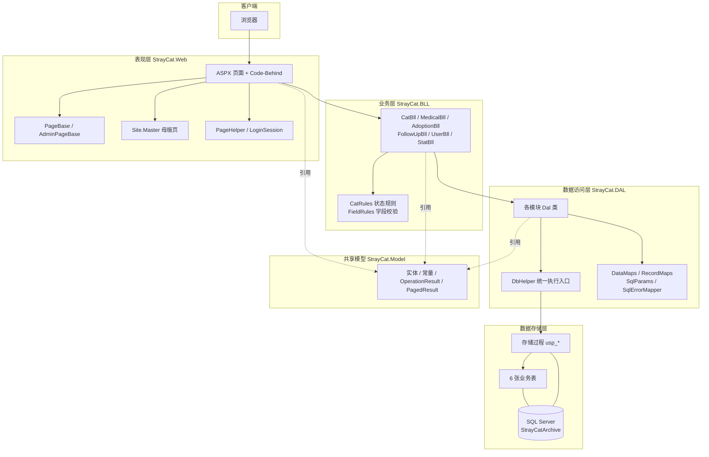

### 2.2 各层职责与约束

| 层 | 项目 | 核心职责 | 允许 | 禁止 |
| --- | --- | --- | --- | --- |
| 表现层 | `StrayCat.Web` | 接收请求、参数读取、调用 BLL、控件绑定、页面跳转 | 引用 BLL、Model | 引用 DAL；出现 SQL；写业务规则 |
| 业务层 | `StrayCat.BLL` | 校验、状态判断、业务编排、密码哈希、分页纠偏 | 引用 DAL、Model | 出现 `SqlCommand`；处理 `HttpContext` |
| 数据访问层 | `StrayCat.DAL` | 组织参数、调用存储过程、结果集映射 | 引用 Model | 业务判断；返回页面文案（映射表除外） |
| 共享模型 | `StrayCat.Model` | 实体、常量、返回值封装 | 仅 .NET 基础类库 | 引用任何其他项目 |
| 测试 | `StrayCat.Tests` | 规则与流程验证 | 引用 BLL、DAL、Model | 被其他项目引用 |

### 2.3 关键架构决策

| 编号 | 决策 | 理由 | 代价 |
| --- | --- | --- | --- |
| ADR-01 | 采用三层架构而非页面直连数据库 | 职责清晰、可测试、便于答辩讲解 | 代码量增加一层转发 |
| ADR-02 | 全部 SQL 收敛到存储过程 | SQL 与代码分离，便于审计与调优；事务写在库内 | 过程与实体需同步维护 |
| ADR-03 | 贫血模型（实体只有属性） | 模型可跨层传输，避免序列化与依赖问题 | 行为集中在 BLL，实体不自洽 |
| ADR-04 | 写操作统一返回 `OperationResult<T>` | 业务失败是常态，避免异常穿透 UI | 调用方需判断 `Success` |
| ADR-05 | 认证用 Session + 页面基类 | 与 Web Forms 天然契合，实现成本低 | 仅适用于单机部署 |
| ADR-06 | 状态/角色/文案常量集中到 Model | 消除魔法值，页面与 BLL 共用同一套语义 | 新增状态需改常量与规则两处 |

---

## 3 项目依赖关系

### 3.1 解决方案组成

| 项目 | 类型 | 目标框架 | 职责 | 项目引用 |
| --- | --- | --- | --- | --- |
| `StrayCat.Model` | 类库（SDK 风格） | net48 | 实体、常量、通用返回值 | 无 |
| `StrayCat.DAL` | 类库（SDK 风格） | net48 | 存储过程调用与行映射 | Model |
| `StrayCat.BLL` | 类库（SDK 风格） | net48 | 业务规则与流程编排 | Model、DAL |
| `StrayCat.Web` | Web 应用（传统 csproj） | net48 | 页面与交互 | Model、BLL |
| `StrayCat.Tests` | 测试项目 | net48 | 单元与流程测试 | Model、DAL、BLL |

### 3.2 依赖关系图

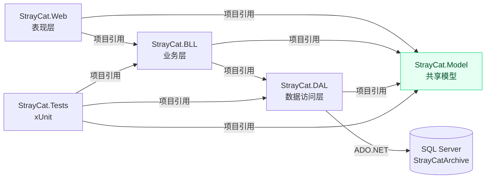

依赖方向说明：

- `StrayCat.Web` **不引用** `StrayCat.DAL`，从工程层面杜绝页面绕过业务层直接访问数据库。
- `StrayCat.DAL` 只依赖 `StrayCat.Model`，可脱离 Web 环境被测试项目直接调用。
- `StrayCat.Model` 是唯一的叶子节点，被三层共同引用，因此不能引入任何项目依赖。

### 3.3 依赖规则清单（可核查）

| 规则 | 核查方式 | 当前状态 |
| --- | --- | --- |
| Web 只引用 BLL、Model | 查看 `StrayCat.Web/StrayCat.Web.csproj` 的 `ProjectReference` | 符合 |
| BLL 引用 DAL、Model | 查看 `StrayCat.BLL/StrayCat.BLL.csproj` | 符合 |
| DAL 引用 Model | 查看 `StrayCat.DAL/StrayCat.DAL.csproj` | 符合 |
| Model 无项目引用 | 查看 `StrayCat.Model/StrayCat.Model.csproj` | 符合 |
| BLL 无 `System.Data.SqlClient` | 全局搜索 `using System.Data.SqlClient` | 符合（仅 DAL 使用） |
| 页面不出现 `new .*Dal(` | 全局搜索 `new CatDal\|new UserDal` | 符合 |

### 3.4 共享模型内容

| 类别 | 类型 | 说明 |
| --- | --- | --- |
| 实体 | `CatArchive`、`RescueRecord`、`MedicalRecord`、`AdoptionRecord`、`FollowUpRecord`、`SysUser` | 与数据表一一对应 |
| 聚合视图 | `CatDetail`（档案 + 接收 + 子记录计数）、`CatListItem`、`HomeCounts`、`MonthStat` | 用于列表与详情 |
| 传输对象 | `CatSearch`、`CurrentUser` | 查询条件、登录态 |
| 返回值 | `OperationResult<T>`（`Success` / `Message` / `Data`）、`PagedResult<T>`（`Items` / `TotalCount` / `PageIndex` / `PageSize`） | 统一结果契约 |
| 常量 | `CatStatuses`、`AdoptionStatuses`、`RoleCodes`、`Lookups`、`Messages` | 状态码、名称映射、提示文案 |

---

## 4 代码层级结构

```text
StrayCat.sln
├─ StrayCat.Web/                    表现层
│  ├─ *.aspx / *.aspx.cs            29 个页面（档案、接收、医疗、领养、回访、用户、统计、认证）
│  ├─ Site.Master(.cs)              统一外壳：顶部导航、当前用户、退出
│  ├─ PageBase.cs                   登录拦截基类，未登录跳转登录页
│  ├─ AdminPageBase.cs              继承 PageBase，追加管理员角色校验
│  ├─ PageHelper.cs                 下拉绑定、日期解析、分页 HTML、图片存取
│  ├─ LoginSession.cs               Session 中的当前用户快照
│  ├─ Captcha.aspx / CaptchaImage.cs / CaptchaSession.cs
│  ├─ Global.asax.cs                全局异常写入 App_Data/logs
│  └─ Content/                      css/site.css、js/site.js
│
├─ StrayCat.BLL/                    业务层
│  ├─ CatBll.cs                     档案查询、建档、修改、删除、状态流转
│  ├─ MedicalBll.cs                 医疗记录增删改查
│  ├─ AdoptionBll.cs                领养登记、修改、退养、删除
│  ├─ FollowUpBll.cs                回访记录增删改查
│  ├─ UserBll.cs                    登录、注册、账号管理、改密
│  ├─ StatBll.cs                    年度列表与月度统计
│  ├─ CatRules.cs                   档案状态机与可操作性判断
│  ├─ FieldRules.cs                 长度、手机号、日期、枚举校验
│  ├─ PasswordHasher.cs             SHA-256 + 每用户随机盐
│  └─ CaptchaCode.cs                验证码生成
│
├─ StrayCat.DAL/                    数据访问层
│  ├─ DbHelper.cs                   连接管理 + 存储过程执行（Query/QueryPage/Execute…）
│  ├─ CatDal.cs / MedicalDal.cs / AdoptionDal.cs
│  ├─ FollowUpDal.cs / UserDal.cs / StatDal.cs
│  ├─ DataMaps.cs / RecordMaps.cs   SqlDataReader → 实体
│  ├─ SqlParams.cs                  类型化参数构造（P/Tiny/Bit）
│  └─ SqlErrorMapper.cs             唯一键冲突等错误 → 中文提示
│
├─ StrayCat.Model/                  共享模型
│  ├─ Records.cs                    五个业务实体
│  ├─ SysUser.cs / CatDetail.cs / CatListItem.cs / HomeCounts.cs
│  ├─ OperationResult.cs / PagedResult.cs
│  ├─ CatStatuses.cs / AdoptionStatuses.cs / RoleCodes.cs / Lookups.cs
│  └─ Messages.cs                   全部提示文案
│
├─ StrayCat.Tests/                  xUnit 测试
├─ Database/                        01 建库 → 06 列表查询与示例数据
├─ docs/                            UML、设计文档、截图
└─ design/                          UML 生成脚本与原型
```

---

## 5 模块设计

### 5.1 功能模块划分

| 模块 | 主要页面 | 业务类 | 数据类 | 存储过程前缀 |
| --- | --- | --- | --- | --- |
| 认证与账号 | `Login`、`Register`、`ChangePassword`、`UserList/Add/Edit` | `UserBll` | `UserDal` | `usp_User_*` |
| 档案管理 | `CatList`、`CatAdd`、`CatDetail`、`CatEdit`、`CatStatus` | `CatBll`、`CatRules` | `CatDal` | `usp_Cat_*` |
| 接收登记 | `CatAdd`（建档同时写入）、`RescueDetail`、`RescueEdit` | `CatBll` | `CatDal` | `usp_Cat_CreateWithRescue`、`usp_Rescue_*` |
| 医疗记录 | `MedicalList/Add/Detail/Edit` | `MedicalBll` | `MedicalDal` | `usp_Medical_*` |
| 领养管理 | `AdoptionList/Add/Detail/Edit` | `AdoptionBll` | `AdoptionDal` | `usp_Adoption_*` |
| 回访跟踪 | `FollowUpList/Add/Detail/Edit` | `FollowUpBll` | `FollowUpDal` | `usp_FollowUp_*` |
| 数据统计 | `Stat` | `StatBll` | `StatDal` | `usp_Stat_*` |
| 公共门户 | `Default`、`Error`、`Site.Master` | `CatBll`、`UserBll` | — | `usp_Cat_HomeCounts`、`*_Recent` |

### 5.2 类职责一览

| 类 | 层 | 职责 |
| --- | --- | --- |
| `PageBase` | Web | `OnInit` 校验登录态；`Leave()` 统一安全跳转 |
| `AdminPageBase` | Web | 在登录基础上校验 `Role == RoleCodes.Admin` |
| `PageHelper` | Web | 控件绑定、日期/页码解析、分页 HTML、上传图片保存与删除 |
| `LoginSession` | Web | Session 读写与清理，向 BLL 提供 `CurrentUser` |
| `CatBll` | BLL | 组合 `CatDal`/`MedicalDal`/`AdoptionDal` 完成档案业务；删除前检查子记录 |
| `CatRules` | BLL | 状态流转合法性、可编辑/可领养/可删除判断 |
| `FieldRules` | BLL | 统一的字段级校验，返回首个错误文案或 `null` |
| `UserBll` | BLL | 登录认证、注册、账号增改、改密、最后一个管理员保护 |
| `DbHelper` | DAL | 打开连接、构造 `SqlCommand`、执行过程、输出参数处理 |
| `SqlErrorMapper` | DAL | 将 SQL 错误号（50000、2601/2627）翻译为业务文案 |
| `DataMaps` / `RecordMaps` | DAL | 将结果集列映射为实体，处理 `DBNull` |

### 5.3 档案状态机

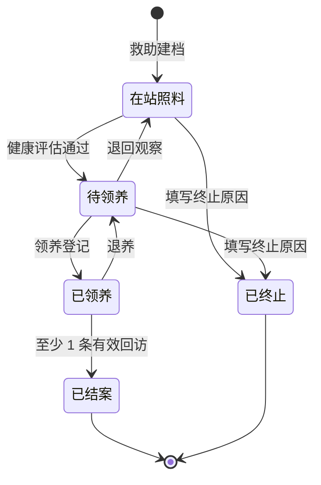

| 当前状态 | 目标状态 | 前置条件 | 校验位置 |
| --- | --- | --- | --- |
| 在站照料(1) | 待领养(2) | 无 | `CatRules.ChangeStatus` + `usp_Cat_ChangeStatus` |
| 待领养(2) | 在站照料(1) | 无 | 同上 |
| 待领养(2) | 已领养(3) | 领养登记成功 | `AdoptionBll.Add` + `usp_Adoption_Create` |
| 已领养(3) | 待领养(2) | 存在有效领养，登记退养 | `AdoptionBll.Return` + `usp_Adoption_Return` |
| 已领养(3) | 已结案(4) | 有效领养下至少 1 条回访 | `CatRules.ChangeStatus` + `usp_Cat_ChangeStatus` |
| 在站照料/待领养 | 已终止(5) | 必须填写终止原因 | 同上 |
| 已结案(4)/已终止(5) | — | 终态，禁止再变更、禁止编辑子记录 | `CatStatuses.IsClosed` + 过程内复检 |

> 注意：`CatStatus.aspx` 的状态页只允许上表中的五种流转（1→2、2→1、3→4、1→5、2→5）。`待领养→已领养` 只能由领养登记触发，`已领养→待领养` 只能由退养登记触发，状态页会以「当前状态不允许此操作」拒绝这两种直接跳转，避免绕过领养数据。

---

## 6 数据访问设计

### 6.1 DbHelper 统一入口

| 方法 | 用途 | 返回 |
| --- | --- | --- |
| `Query<T>(procedure, map, parameters)` | 查询多行并逐行映射 | `List<T>` |
| `QueryPage<T>(procedure, map, parameters)` | 分页查询，自动追加 `@TotalCount` 输出参数 | `PagedResult<T>` |
| `ExecuteScalarInt(procedure, parameters)` | 取单个整数（计数） | `int` |
| `ExecuteReturnId(procedure, outputName, parameters)` | 插入并取回自增主键 | `OperationResult<int>` |
| `Execute(procedure, parameters)` | 增删改 | `OperationResult<int>` |

所有方法内部统一使用 `using` 释放 `SqlConnection` / `SqlCommand` / `SqlDataReader`，并将 `CommandType` 固定为 `StoredProcedure`。

### 6.2 存储过程组织

按模块前缀命名：`usp_模块_动作`。全部 41 个过程按模块分布如下：

| 模块 | 过程 |
| --- | --- |
| 用户（9） | `GetByUserName`、`CountEnabled`、`Insert`、`Update`、`SetEnabled`、`ChangePassword`、`GetById`、`Search`、`CountEnabledAdmins` |
| 档案（8） | `HomeCounts`、`Recent`、`CreateWithRescue`、`Update`、`GetDetail`、`Search`、`Delete`、`ChangeStatus` |
| 接收（2） | `Update`、`GetByCatId` |
| 医疗（6） | `Insert`、`Update`、`Delete`、`GetById`、`ListByCat`、`Recent` |
| 领养（7） | `Create`、`Update`、`Return`、`Delete`、`GetById`、`ListByCat`、`Recent` |
| 回访（7） | `Insert`、`Update`、`Delete`、`GetById`、`ListByAdoption`、`CountByAdoption`、`Recent` |
| 统计（2） | `Monthly`、`Years` |

关键过程说明：

| 过程 | 职责 | 关键技术点 |
| --- | --- | --- |
| `usp_Cat_CreateWithRescue` | 同时创建档案与接收记录，生成档案编号 | 事务；`UPDLOCK, HOLDLOCK` 取当年最大序号；`SCOPE_IDENTITY()` 回填主键 |
| `usp_Cat_Search` | 关键字/状态/性别/接收日期过滤 + 分页 | 两次查询（计数 + 分页）；`OFFSET ... FETCH NEXT`；LIKE 通配符转义 |
| `usp_Cat_ChangeStatus` | 档案状态流转 | 事务；行锁读取当前状态；按目标状态复检；`RAISERROR` 返回业务错误 |
| `usp_Adoption_Create` | 领养登记并将档案置为已领养 | 事务；校验状态=2、唯一有效领养、日期不早于接收日期 |
| `usp_Adoption_Return` | 退养并将档案退回待领养 | 事务；同时更新领养状态与档案状态 |
| `usp_Cat_GetDetail` | 档案 + 接收 + 医疗数 + 领养数 | 单次往返返回详情页所需全部字段 |

### 6.3 参数与结果映射

- **参数构造**：`SqlParams.P/Tiny/Bit` 统一处理类型与 `DBNull`，避免各 DAL 重复写 `new SqlParameter`。
- **行映射**：`DataMaps` 负责列表类实体，`RecordMaps` 负责详情与子记录；所有字符串读取后 `Trim()`，`DBNull` 转为 `null`。
- **集合结果**：单行结果在 DAL 内取 `rows[0]`，无记录返回 `null`，由 BLL 转为「记录不存在」。

### 6.4 异常与错误映射

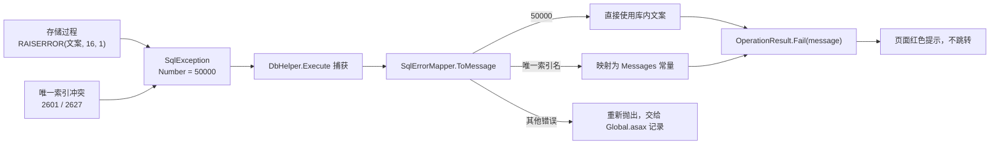

设计要点：**可预期错误**（状态不允许、必填缺失、编号冲突）以业务结果返回；**不可预期错误**（连接失败、语法错误）继续抛出并落盘日志。

### 6.5 事务、锁与并发

| 机制 | 使用位置 | 作用 |
| --- | --- | --- |
| `BEGIN TRANSACTION` + `TRY/CATCH` + `THROW` | 建档、状态流转、领养、退养、删除 | 多表写入原子性 |
| `SET XACT_ABORT ON` | 同上 | 任一语句出错自动回滚 |
| `WITH (UPDLOCK, HOLDLOCK)` | 读取档案/领养当前状态、生成档案编号 | 防止并发重复编号与状态竞争 |
| 唯一索引 `UQ_CatArchive_CatNo` | 档案表 | 编号兜底唯一 |
| 唯一筛选索引 `UX_Adoption_OneActive` | 领养表 `WHERE Status = 1` | 保证「一只猫最多一条有效领养」 |
| CHECK 约束 | 档案/领养/回访表 | 状态与终止原因、退养原因的成对约束 |

### 6.6 数据库对象概览

| 表 | 主键 | 关键约束/索引 | 说明 |
| --- | --- | --- | --- |
| `SysUser` | `UserId` | `UQ_SysUser_UserName`、`CK_SysUser_Role(1,2)` | 账号、密码哈希、盐、角色、启用状态 |
| `CatArchive` | `CatId` | `UQ_CatArchive_CatNo`、状态/性别 CHECK、终止原因成对约束 | 档案主表，编号格式 `CAT + 年份 + 4 位序号` |
| `RescueRecord` | `RescueId` | `UQ_RescueRecord_CatId` | 与档案一对一，保存接收时间、地点、发现方式 |
| `MedicalRecord` | `MedicalId` | `IX_CatId` | 可多条，日期不得早于接收日期 |
| `AdoptionRecord` | `AdoptionId` | `UX_Adoption_OneActive`、退养字段成对约束 | 保存领养人信息、状态（1 有效 / 2 已退养） |
| `FollowUpRecord` | `FollowUpId` | `IX_AdoptionId`、回访方式 CHECK | 回访方式限定为电话/上门/微信 |

---

## 7 调用链示例

### 7.1 示例一：登录认证

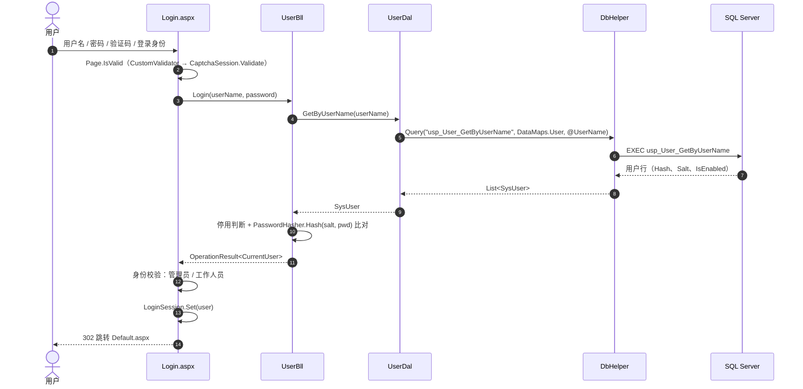

| 步骤 | 代码位置 | 说明 |
| --- | --- | --- |
| 1 | `Login.aspx.cs` `LoginButton_Click` | 先判断 `Page.IsValid`，验证码校验由 `CustomValidator` 完成 |
| 2 | `UserBll.Login` | 空值判断后按用户名查库 |
| 3 | `UserDal.GetByUserName` | 只传一个参数，单行结果取首条 |
| 4 | `DbHelper.Query` | 统一 `StoredProcedure` 执行与映射 |
| 5 | `UserBll.Authenticate` | 停用、空密码、哈希比对三连校验 |
| 6 | `Login.aspx.cs` | 校验所选身份与账号角色一致，写入 Session |
| 7 | `LoginSession.Set` | 仅存 `UserId/UserName/RealName/Role`，不存敏感字段 |

关键点：密码比对使用 `StringComparison.OrdinalIgnoreCase`，哈希为 SHA-256 + 每用户 32 位十六进制盐；登录失败统一返回「用户名或密码错误」，不区分账号是否存在。

### 7.2 示例二：档案分页检索

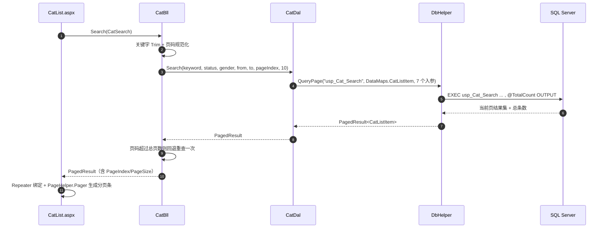

| 环节 | 处理内容 |
| --- | --- |
| 页面 | 从查询字符串读取筛选条件；起止日期倒置时直接提示，不发起查询 |
| BLL | 关键字清洗；`PageSize = 10`；超界页码自动回退 |
| DAL | 7 个入参 + 输出参数，无任何 SQL 文本 |
| 过程 | 先 `COUNT(*)` 写 `@TotalCount`，再 `OFFSET/FETCH` 取当前页；LIKE 特殊字符转义 |
| 映射 | `DataMaps.CatListItem` 逐列读取，`DBNull` 安全处理 |

### 7.3 示例三：档案状态流转（结案）

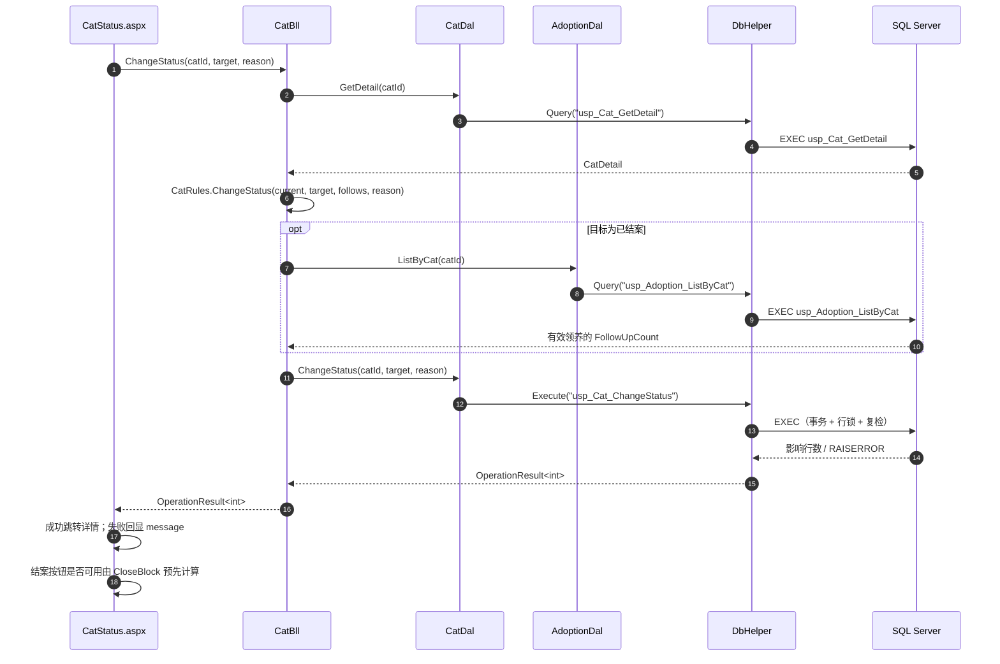

该链路体现**双保险校验**：页面先调用 `CloseBlock` 决定按钮是否可点；BLL 用 `CatRules` 预检；存储过程在事务内再次校验，三层任何一层发现不满足都会拒绝。

### 7.4 示例四：领养登记

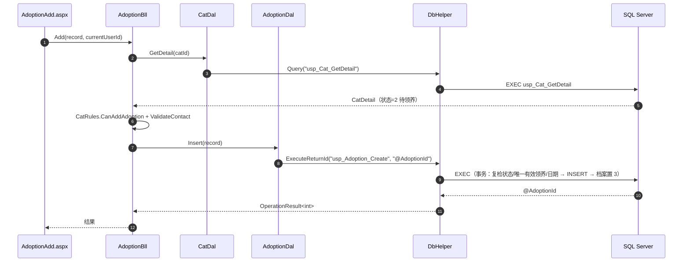

| 校验层次 | 内容 |
| --- | --- |
| 页面 | 必填项、日期格式、下拉选项 |
| BLL | 档案必须存在且为「待领养」；领养人姓名/手机号/地址；领养日期不早于接收日期 |
| 数据库 | 状态复检、唯一有效领养索引、日期复检；插入领养与更新档案状态在同一事务 |

### 7.5 异常路径示例

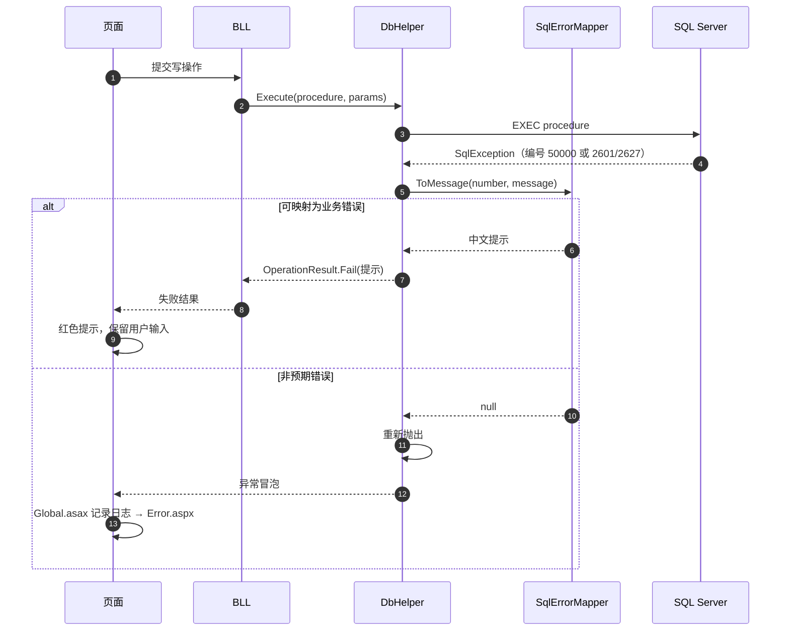

### 7.6 调用链汇总

| 操作 | 页面 | BLL | DAL | 存储过程 |
| --- | --- | --- | --- | --- |
| 登录 | `Login.aspx` | `UserBll.Login` | `UserDal.GetByUserName` | `usp_User_GetByUserName` |
| 档案列表 | `CatList.aspx` | `CatBll.Search` | `CatDal.Search` | `usp_Cat_Search` |
| 档案详情 | `CatDetail.aspx` | `CatBll.GetDetail` | `CatDal.GetDetail` | `usp_Cat_GetDetail` |
| 救助建档 | `CatAdd.aspx` | `CatBll.Create` | `CatDal.Create` | `usp_Cat_CreateWithRescue` |
| 状态流转 | `CatStatus.aspx` | `CatBll.ChangeStatus` | `CatDal.ChangeStatus` | `usp_Cat_ChangeStatus` |
| 医疗新增 | `MedicalAdd.aspx` | `MedicalBll.Add` | `MedicalDal.Insert` | `usp_Medical_Insert` |
| 领养登记 | `AdoptionAdd.aspx` | `AdoptionBll.Add` | `AdoptionDal.Insert` | `usp_Adoption_Create` |
| 退养 | `AdoptionEdit.aspx` | `AdoptionBll.Return` | `AdoptionDal.Return` | `usp_Adoption_Return` |
| 回访新增 | `FollowUpAdd.aspx` | `FollowUpBll.Add` | `FollowUpDal.Insert` | `usp_FollowUp_Insert` |
| 月度统计 | `Stat.aspx` | `StatBll.Monthly` | `StatDal.Monthly` | `usp_Stat_Monthly` |

---

## 8 横切设计

### 8.1 认证与授权

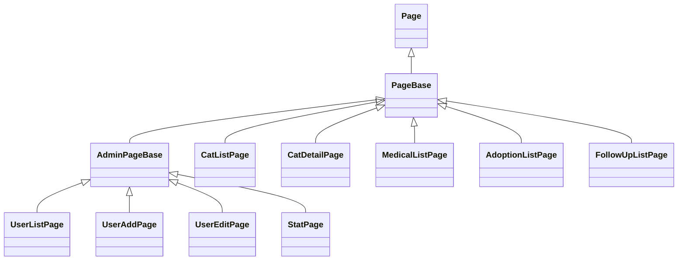

> 图中仅列出代表性页面。29 个页面中：25 个继承 `PageBase`，其中 `Stat`、`UserList`、`UserAdd`、`UserEdit` 4 个继承 `AdminPageBase`；`Login`、`Register`、`Error`、`Captcha` 直接继承 `Page`。

- 普通业务页继承 `PageBase`：`OnInit` 中无登录态则跳转 `Login.aspx?msg=expired`，并通过 `Redirecting` 标志阻止后续生命周期继续执行。
- 管理页继承 `AdminPageBase`：追加 `Role != RoleCodes.Admin` 判断，跳转 `Default.aspx?msg=forbidden`。
- 登录页与注册页直接继承 `Page`，避免被登录拦截。
- 母版页 `Site.Master` 根据 `LoginSession.Current.IsAdmin` 控制管理菜单显示。

### 8.2 统一返回与分页

- 写操作：`OperationResult<T>`，调用方只判断 `Success`，失败直接展示 `Message`。
- 列表：`PagedResult<T>`，BLL 负责设置 `PageIndex/PageSize` 并纠正越界页码，页面只负责渲染。
- 分页条：`PageHelper.Pager` 生成「上一页/页码窗口/下一页」HTML，保留原筛选参数。

### 8.3 输入校验

| 层次 | 校验内容 |
| --- | --- |
| 页面 | 控件验证、日期格式、必填提示、验证码 |
| BLL `FieldRules` | 长度、手机号正则、用户名正则、密码长度、日期范围与顺序、枚举可选值 |
| BLL `CatRules` | 状态是否允许编辑/领养/结案/删除 |
| 数据库 | 类型、CHECK 约束、外键、唯一索引、过程内业务复检 |

页面、BLL、数据库三层对同一规则各守一段，保证绕过前端也无法写入非法数据。

### 8.4 文件上传

`PageHelper.SavePhoto` / `DeletePhoto` / `ShowPhoto` 统一处理档案照片：

- 仅允许 `.jpg/.jpeg/.png`，大小上限 2 MB；
- 文件名使用 GUID 重命名，存入 `Uploads/cats/`；
- 删除时校验路径前缀并阻止 `..` 穿越，删除失败静默忽略；
- 展示时校验文件真实存在，缺失则不渲染图片。

### 8.5 日志

`Global.asax.cs` 的 `Application_Error` 捕获未处理异常，忽略 `ThreadAbortException`，将「时间 + URL + 用户名 + 异常」追加写入 `App_Data/logs/yyyyMMdd.txt`，随后由 `customErrors` 跳转 `Error.aspx`。

### 8.6 文案与常量

所有面向用户的中文提示集中在 `Messages.cs`；状态名称、性别、绝育、角色、发现方式、回访方式集中在 `CatStatuses`、`Lookups`、`RoleCodes`。页面与 BLL 引用同一常量，避免同一提示出现多种写法。

---

## 9 部署与配置

### 9.1 环境要求

| 项 | 要求 |
| --- | --- |
| 操作系统 | Windows 10/11 或 Windows Server |
| 运行环境 | .NET Framework 4.8 |
| Web 服务器 | IIS Express（开发）/ IIS（部署） |
| 数据库 | SQL Server 2012 及以上（使用 `OFFSET/FETCH`、`THROW`） |
| 开发工具 | Visual Studio 2022 及以上（含 ASP.NET 工作负载） |

### 9.2 数据库初始化顺序

| 顺序 | 脚本 | 作用 |
| --- | --- | --- |
| 1 | `Database/01_CreateDatabase.sql` | 创建 `StrayCatArchive` 数据库 |
| 2 | `Database/02_CreateTables.sql` | 建 6 张表、约束与索引 |
| 3 | `Database/03_CreateProcedures.sql` | 首页统计与最近档案等基础过程 |
| 4 | `Database/04_Seed.sql` | 初始管理员 `admin`（初始密码 `Admin@123`） |
| 5 | `Database/05_BusinessProcedures.sql` | 业务过程（用户、档案、医疗、领养、回访、统计） |
| 6 | `Database/06_ModuleLists.sql` | 模块列表过程 + 4 条示例档案 |

> 脚本可重复执行：建表脚本先 `DROP` 再 `CREATE`，种子数据带存在性判断。

### 9.3 站点关键配置

| 配置项 | 值 | 说明 |
| --- | --- | --- |
| 连接字符串 `StrayCatDb` | `Data Source=localhost\SQLEXPRESS;Initial Catalog=StrayCatArchive;Integrated Security=True;MultipleActiveResultSets=True` | 按实际实例修改 |
| 编译目标 | `targetFramework="4.8"` | 与项目一致 |
| 会话 | `InProc`，30 分钟 | 单机部署 |
| 默认文档 | `Login.aspx` | 未登录先进登录页 |
| 错误页 | `~/Error.aspx` | `customErrors mode="On"` |
| 请求大小 | 10 MB | 与图片上传限制配合 |
| 全球化 | `zh-CN` / UTF-8 | 中文提示与日期显示 |
| 验证模式 | `UnobtrusiveValidationMode = None` | 免配置脚本映射 |

### 9.4 启动与验证

1. 在 SSMS 中按 9.2 顺序执行脚本。
2. 用 Visual Studio 打开 `StrayCat.sln`，将 `StrayCat.Web` 设为启动项目。
3. F5 启动 IIS Express，浏览器打开登录页。
4. 使用 `admin` / `Admin@123` 登录 → 首页应显示统计卡片与最近档案。
5. 依次验证：新建档案 → 添加医疗 → 改为待领养 → 领养登记 → 添加回访 → 结案。

---

## 10 测试策略

| 测试类 | 覆盖点 |
| --- | --- |
| `CatRulesTests` | 状态流转合法性、可编辑/可删除判断、领养资格文案 |
| `PasswordHasherTests` | 同盐同密码结果稳定、不同盐结果不同 |
| `UserBllAuthenticateTests` | 密码错误、账号停用、空密码、登录成功 |
| `UserBllRegisterTests` | 两次密码不一致、用户名/密码规则、默认角色与启用状态 |
| `CaptchaCodeTests` | 验证码长度与字符集 |
| `SqlErrorMapperTests` | 50000 直接透传、唯一索引名映射、其他错误返回 `null` |
| `BusinessFlowTests` | 依赖本机数据库，串联建档 → 医疗 → 领养 → 回访 → 结案，并覆盖删除与账号规则 |
| `LoginDatabaseTests` | 依赖本机数据库，验证种子管理员 `admin` 可使用初始密码登录 |

分层带来的可测试性：BLL 通过构造函数注入 `connectionString` 或 `DbHelper`，测试无需启动 IIS；DAL 可脱离页面直接对测试库执行。

---

## 11 已知约束与演进建议

| 约束 | 影响 | 建议 |
| --- | --- | --- |
| Session `InProc` 保存登录态 | 无法多机负载均衡，重启即掉线 | 引入 Redis/State Server 或改为 Token 认证 |
| 密码使用单轮 SHA-256 + 盐 | 抗暴力破解能力有限 | 升级为 PBKDF2 / BCrypt / Argon2，并支持旧哈希迁移 |
| 业务规则在 BLL 与存储过程各写一份 | 修改规则需同步两处 | 关键规则以数据库为准，BLL 只做快速失败提示 |
| 无 CSRF 防护 | 表单存在跨站提交风险 | 增加防伪 Token 或在 `PageBase` 校验 Referer |
| 上传仅校验扩展名与大小 | 未校验文件头 | 增加魔数校验与图片重编码 |
| 无审计日志表 | 关键操作不可追溯 | 增加 `OperationLog` 表，记录操作人、对象与时间 |

---

## 12 C 端入口与角色权限

### 12.1 角色划分

| 角色码 | 角色 | 可见入口 | 权限范围 |
| --- | --- | --- | --- |
| 1 | 管理员 | 全部页面 | 档案、接收、医疗、领养、回访、统计、用户管理，以及上报审核与领养申请审核 |
| 2 | 普通用户 | `Default`、`Adoptable`、`AdoptableDetail`、`ReportAdd`、`ApplyAdoption`、`MyCenter`、`ChangePassword` | 浏览可领养猫、上报流浪猫、提交领养申请、查看本人上报与申请 |

访问控制沿用页面基类：

| 页面类型 | 基类 | 未登录 / 越权行为 |
| --- | --- | --- |
| 公开页 `Adoptable`、`AdoptableDetail` | `Page` | 匿名可直接访问 |
| C 端登录页 `ReportAdd`、`ApplyAdoption`、`MyCenter` | `PageBase` | 302 跳转 `Login.aspx?msg=expired&returnUrl=<原地址>`，登录成功后回到原页面 |
| 审核页 `ReportList`、`ReportApprove`、`ApplicationList` 及全部后台管理页 | `AdminPageBase` | 未登录跳登录页；普通用户跳 `Default.aspx?msg=forbidden` |

`Site.Master` 仅在 `LoginSession.Current.IsAdmin` 为真时渲染 `AdminMenu`，普通用户菜单只保留「领养与上报」「我的中心」「修改密码」，即使手工输入 `/CatList.aspx`、`/Stat.aspx`、`/UserList.aspx` 也会被 `AdminPageBase` 挡回首页。

### 12.2 C 端页面

| 页面 | 功能 | 访问 | 主要数据来源 |
| --- | --- | --- | --- |
| `Adoptable.aspx` | 可领养猫列表，仅展示状态为「待领养」的档案，每页 12 条 | 匿名 | `usp_Cat_ListAdoptable` |
| `AdoptableDetail.aspx` | 公开展示可领养猫详情（接收信息、医疗数、领养数）；无效或非待领养 id 显示「记录不存在」提示而非报错 | 匿名 | `usp_Cat_GetPublicDetail` |
| `ReportAdd.aspx` | 上报流浪猫：发现地点、发现日期、描述、照片、联系电话 | 登录用户 | `usp_Report_Create` |
| `ApplyAdoption.aspx` | 领养申请：申请人姓名、电话、地址、申请理由；由详情页「申请领养」进入 | 登录用户 | `usp_Application_Create` |
| `MyCenter.aspx` | 我的上报 + 我的领养申请，展示状态与驳回理由，分别分页 | 登录用户 | `usp_Report_ListByUser`、`usp_Application_ListByUser` |

### 12.3 新增数据表

`Database/07_CitizenPortal.sql` 以存在性判断建表建过程，可重复执行。

| 表 | 关键字段 | 约束与索引 | 说明 |
| --- | --- | --- | --- |
| `StrayReport` | `ReportId`、`UserId`、`FoundPlace`、`FoundDate`、`Description`、`PhotoPath`、`ContactPhone`、`Status`、`RejectReason`、`CatId`、`AuditUserId`、`AuditTime` | `FK_StrayReport_User/Cat/Audit`；`CK_Status IN (1,2,3)`；`CK_Approved`（采纳必有 `CatId`）；`CK_Rejected`（驳回必有理由）；`IX_Status`、`IX_User` | 市民上报，状态 1 待审核 / 2 已采纳 / 3 已驳回 |
| `AdoptionApplication` | `ApplicationId`、`CatId`、`UserId`、`ApplicantName`、`Phone`、`Address`、`Reason`、`Status`、`RejectReason`、`AdoptionId`、`AuditUserId`、`AuditTime` | `FK_..._Cat/User/Adoption/Audit`；`CK_Status IN (1,2,3)`；`CK_Approved`（通过必有 `AdoptionId`）；`CK_Rejected`（驳回必有理由）；唯一筛选索引 `UX_AdoptionApplication_Pending (UserId, CatId) WHERE Status = 1` | 领养申请，同一用户对同一只猫最多一条待审核申请 |

本次共新增 13 个存储过程：上报 6 个（`usp_Report_Create/ListByUser/Search/Approve/Reject/GetById`）、申请 5 个（`usp_Application_Create/ListByUser/Search/Approve/Reject`）、公开查询 2 个（`usp_Cat_ListAdoptable`、`usp_Cat_GetPublicDetail`）。

### 12.4 审核闭环

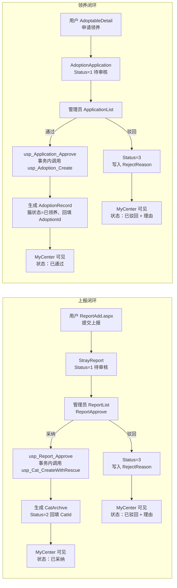

两条闭环的关键点：

- **原子性**：采纳调用 `usp_Report_Approve`，在事务内先以 `UPDLOCK, HOLDLOCK` 读取上报状态，再调用建档过程并回写上报表；通过申请调用 `usp_Application_Approve`，在事务内调用领养过程并回写申请表。任一步失败整体回滚。
- **状态复检**：两个审核过程都要求当前状态为 1，重复审核返回「当前状态不允许此操作」；上报采纳时接收地点取上报的发现地点、发现方式固定为「市民送交」。
- **重复申请兜底**：`UX_AdoptionApplication_Pending` 唯一筛选索引保证同一用户对同一只猫只有一条待审核申请，BLL 预检与索引约束形成双保险。
- **权限隔离**：C 端页面只读写 `StrayReport`、`AdoptionApplication` 与公开只读查询，档案、领养记录等写操作仍由管理员页面完成，普通用户无法绕过 `AdminPageBase` 直接修改业务数据。

---

## 附录 A 存储过程全量清单

| 序号 | 过程名 | 类型 |
| --- | --- | --- |
| 1 | `usp_User_GetByUserName` | 查询 |
| 2 | `usp_User_CountEnabled` | 查询 |
| 3 | `usp_User_GetById` | 查询 |
| 4 | `usp_User_Search` | 分页查询 |
| 5 | `usp_User_CountEnabledAdmins` | 查询 |
| 6 | `usp_User_Insert` | 写入 |
| 7 | `usp_User_Update` | 写入 |
| 8 | `usp_User_SetEnabled` | 写入 |
| 9 | `usp_User_ChangePassword` | 写入 |
| 10 | `usp_Cat_HomeCounts` | 查询 |
| 11 | `usp_Cat_Recent` | 查询 |
| 12 | `usp_Cat_CreateWithRescue` | 事务写入 |
| 13 | `usp_Cat_Update` | 写入 |
| 14 | `usp_Cat_GetDetail` | 查询 |
| 15 | `usp_Cat_Search` | 分页查询 |
| 16 | `usp_Cat_Delete` | 事务写入 |
| 17 | `usp_Cat_ChangeStatus` | 事务写入 |
| 18 | `usp_Rescue_Update` | 写入 |
| 19 | `usp_Rescue_GetByCatId` | 查询 |
| 20 | `usp_Medical_Insert` | 写入 |
| 21 | `usp_Medical_Update` | 写入 |
| 22 | `usp_Medical_Delete` | 写入 |
| 23 | `usp_Medical_GetById` | 查询 |
| 24 | `usp_Medical_ListByCat` | 查询 |
| 25 | `usp_Medical_Recent` | 查询 |
| 26 | `usp_Adoption_Create` | 事务写入 |
| 27 | `usp_Adoption_Update` | 写入 |
| 28 | `usp_Adoption_Return` | 事务写入 |
| 29 | `usp_Adoption_Delete` | 写入 |
| 30 | `usp_Adoption_GetById` | 查询 |
| 31 | `usp_Adoption_ListByCat` | 查询 |
| 32 | `usp_Adoption_Recent` | 查询 |
| 33 | `usp_FollowUp_Insert` | 写入 |
| 34 | `usp_FollowUp_Update` | 写入 |
| 35 | `usp_FollowUp_Delete` | 写入 |
| 36 | `usp_FollowUp_GetById` | 查询 |
| 37 | `usp_FollowUp_ListByAdoption` | 查询 |
| 38 | `usp_FollowUp_CountByAdoption` | 查询 |
| 39 | `usp_FollowUp_Recent` | 查询 |
| 40 | `usp_Stat_Monthly` | 查询 |
| 41 | `usp_Stat_Years` | 查询 |

> 说明：`03_CreateProcedures.sql` 与 `05_BusinessProcedures.sql` 各自定义了一次 `usp_Cat_Recent`，因此脚本中 `CREATE PROCEDURE` 语句共 42 条，去重后为 41 个过程；后执行的 05 版本覆盖 03 版本，两者结果一致。

## 附录 B 相关设计资料

| 资料 | 文件 |
| --- | --- |
| 功能结构图 | `docs/uml/png/01-功能结构图.png` |
| 用例图 | `docs/uml/png/02-用例图.png` |
| 实体类图 | `docs/uml/png/03-实体类图.png` |
| 分层类图 | `docs/uml/png/04-分层类图.png` |
| 顺序图（救助建档） | `docs/uml/png/05-顺序图-救助建档.png` |
| 顺序图（领养登记） | `docs/uml/png/06-顺序图-领养登记.png` |
| 活动图（救助与领养主流程） | `docs/uml/png/07-活动图-救助与领养主流程.png` |
| 状态图（档案状态流转） | `docs/uml/png/08-状态图-档案状态流转.png` |
| 图说明 | `docs/uml/图说明.md` |
| 毕设要求对照 | `docs/毕设要求对照.md` |
